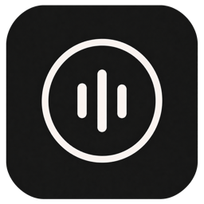

# Reco

<p align="center">
  
</p>

Reco is a minimal macOS menu bar transcription app. Hold a configurable global shortcut to record a connected microphone, system audio, or both; release it to transcribe the captured audio, and Reco copies and pastes the result into the active app. Reco discovers connected microphones automatically and prefers the Mac's built-in microphone unless you choose another input. Double-tap the shortcut to latch recording on, then press it once to stop.

Transcription runs locally with NVIDIA Parakeet TDT 0.6B v3 through FluidAudio and Core ML. The model is downloaded from Hugging Face on first launch; after that download, recorded audio is processed on-device. Temporary recordings are deleted after transcription.

## Download

Download the signed and notarized macOS app from the [GitHub Releases page](https://github.com/danielcorin/Reco/releases).

## Why

I built this because I wanted an open source, open weights, minimal, hotkey-based transcription app that wasn't bloated, prone to frequent breaking, bound to a cloud provider, or trying to upsell me. At least if this one breaks, it's my fault and I can fix it on my terms.

## AI disclosure

I made Reco using a few different coding agent tools and LLMs.

## Requirements

- macOS 14 or later
- Xcode with Swift 6 support
- An Apple Silicon Mac is recommended for Core ML performance
- Microphone, Screen & System Audio Recording, and Accessibility permissions

## Build

1. Clone the repository and open `Reco.xcodeproj`.
2. Copy `Configuration/Local.xcconfig.example` to `Configuration/Local.xcconfig`.
3. Set `DEVELOPMENT_TEAM` to your Apple Developer Team ID and choose a unique `PRODUCT_BUNDLE_IDENTIFIER`.
4. Select the Reco scheme and run the app.

`Local.xcconfig` is ignored by Git so developer account details do not become part of the project. An unsigned command-line build can be run with:

```sh
xcodebuild \
  -project Reco.xcodeproj \
  -scheme Reco \
  -destination 'platform=macOS' \
  CODE_SIGNING_ALLOWED=NO \
  test
```

The app build embeds the `reco` companion CLI at
`Reco.app/Contents/Helpers/reco`.

## Recording from the CLI

The companion CLI can record through the running Reco app, using the same
selected microphone, system audio, local transcription model, and temporary-file
cleanup as hotkey dictation:

```sh
reco record --duration 30 > transcript.txt  # capture for 30 seconds, then transcribe
reco record                               # stop with Ctrl-C or from another process
reco stop                                 # stop the active CLI recording
reco record --duration 5 --json            # {"text": "..."}
```

`reco record` waits for transcription and prints the result to stdout. Progress
goes to stderr. It does not paste text or change the clipboard. The duration is
in seconds (fractions are supported), measured after capture starts.

Without a duration, capture continues until `reco stop`, Ctrl-C, `SIGINT`,
`SIGTERM`, or `SIGHUP`. Signals request a graceful stop: the command stays alive
until it returns the transcript. For example, another process can stop it with
`kill -TERM <record-command-pid>`. If the CLI disappears unexpectedly, the app
also stops capture and cleans up its temporary audio.

`reco stop` acknowledges the stop immediately; the original `reco record`
process receives the transcript. It only stops CLI recordings. Only one capture
can be active at a time; an overlapping request returns an error. The hotkey is
ignored while CLI capture is active. Transcription keeps its existing queue, so
a new recording can begin while an earlier clip is being transcribed.

Open Reco and let its model finish loading before recording. The app needs
permission for the selected audio sources; CLI transcription does not need
Accessibility access. No speech, unavailable permissions, or other failures
produce an error on stderr and exit status 1; invalid arguments exit with status 2.
A successful transcript or stop acknowledgement exits with status 0.
`reco stop --json` returns `{"stopping": true}`.

## Transcribing an audio file from the CLI

With Reco running and its model ready, transcribe an existing local audio file:

```sh
reco transcribe ./meeting.m4a > transcript.txt
reco transcribe ./meeting.wav --json  # {"text": "..."}
```

The command uses the same on-device model and transcription queue as recording.
It makes a temporary copy so Reco can read files from locations such as Downloads,
deletes that copy when the command finishes, and leaves the original unchanged.
It prints the transcript to stdout without pasting or changing the clipboard. A missing or unreadable file,
unsupported audio, or no detected speech produces an error on stderr.

## Usage stats

Reco counts each successful transcription (hotkey, `reco record`, and
`reco transcribe`) and the words it produced. The **Usage** section of Reco's
menu shows lifetime totals and a bar chart of words or transcriptions per day
over the last 30 days; click a total to chart it, and hover a bar to see that
day's count. The same numbers are
available from the CLI, whether or not Reco is running:

```sh
reco stats              # totals, then one row per day for the last 30 days
reco stats --days 7     # a shorter daily range; --days 0 prints totals only
reco stats --json       # {"transcriptions", "words", "since", "days": [...]}
```

Stats live in `$XDG_DATA_HOME/reco/stats.json` (`~/.local/share/reco/stats.json`
when `XDG_DATA_HOME` is unset or relative) as per-day counts in local time.
Transcript text is never stored. Delete the file to reset the counts.

## Vocabulary and context

Reco fits each dictation to the text around the cursor and learns the words you
use:

- **Fits the sentence.** In apps whose text fields are readable over
  Accessibility (most native Mac apps), Reco reads up to 300 characters on each
  side of the cursor. Dictating mid-sentence lowercases the first word (except
  for "I", acronyms, names, and vocabulary words), drops the trailing period when
  the sentence continues after the cursor, and adds the spaces the surrounding
  text needs. Password fields are never read. Where the field can't be read
  (Ghostty, cmux, many Electron apps), text is inserted exactly as transcribed.
- **Listens for your words.** A second, small model (Parakeet CTC 110M) scores
  the same recording alongside Parakeet. Reco swaps in a vocabulary word only
  when that model's acoustic evidence supports it. Each dictation's word list
  combines your vocabulary with names and identifiers taken from the text around
  the cursor and the window title. The list is built while you speak; the second
  model adds roughly 40–80 ms after you release the shortcut.
- **Learns from your corrections.** Reco remembers its last insertion in memory
  only. On your next dictation, or 90 seconds later, it rereads that span; if you
  swapped one to three words for something that sounds similar, it saves the pair
  as a `heard` spelling and applies it from then on. If you change a learned fix
  back, Reco forgets it. The **Vocabulary** section of the menu lists recent
  fixes; hover one (or right-click it) to stop making it.

The vocabulary lives in `vocabulary.toml` beside the configuration file, so it
travels with your dotfiles and works with any recognition model:

```toml
[[term]]
text = "Reco"
heard = ["Rico", "eco"]
source = "taught"   # or "learned"
```

```sh
reco vocab                                  # list terms
reco vocab add Reco --heard Rico            # teach a word and a misheard spelling
reco vocab add "pull request"               # quote phrases
reco vocab remove Reco --heard Rico         # stop one fix; omit --heard to remove the word
reco vocab path
```

Only word pairs are stored, never transcripts. See the
[configuration guide](docs/Configuration.md#vocabulary) for details.

## Configuration and CLI

See the [configuration guide](docs/Configuration.md) for the complete schema,
path rules, CLI behavior, direct-edit workflow, and migration details.

Reco uses a human-readable TOML file for runtime configuration:

```text
$XDG_CONFIG_HOME/reco/config.toml
```

When `XDG_CONFIG_HOME` is unset or relative, Reco uses
`~/.config/reco/config.toml`. The file is optional and contains only values
that differ from Reco's built-in defaults. For example:

```toml
hotkey = "shift+command+space"
show-menu-bar-icon = false
```

Changing the shortcut or menu-bar visibility in the app updates this same
file. Existing `UserDefaults` values from older Reco versions are migrated on
first launch. Manual edits are watched while Reco runs; invalid edits leave the
last valid configuration active and appear as an error in the menu.

Choose **Install Command Line Tool…** from the gear menu in Reco's menu to symlink the
bundled executable to `~/.local/bin/reco`. Ensure `~/.local/bin` is on `PATH`,
then use:

```sh
reco config path
reco config get hotkey
reco config set hotkey command+shift+space
reco config set show-menu-bar-icon false
reco config unset hotkey
reco config list             # overrides only
reco config list --all       # effective values and their source
reco config validate
reco config reload
```

Every command accepts `--json`. `set` validates values before an atomic write;
setting a key to its built-in default removes that override. The configuration
file is for non-secret user preferences. Credentials belong in Keychain, and
build/signing configuration remains in `Configuration/Local.xcconfig` or the
ignored `.env` file.

## Publishing a release

The release script reads the version, build number, and bundle ID from the resolved Xcode settings. It prefers signing details from the release environment and falls back to the ignored `Configuration/Local.xcconfig`; no real Apple team ID or credentials are stored in the repository.

Copy the release environment template, fill in your Apple credentials and
repository, then trust the committed [mise](https://mise.jdx.dev/)
configuration once:

```sh
cp .env.example .env
$EDITOR .env
mise trust
```

`mise exec --` loads the ignored `.env` and redacts its values from mise output.
The file uses `APPLE_ID`, `APPLE_ID_PASSWORD`, `DEVELOPER_ID_APPLICATION`, and
`TEAM_ID`. On the first release, the script validates those values and stores
the [app-specific password](https://support.apple.com/102654) in the
`RecoNotary` Keychain profile. Later releases reuse the Keychain profile.
`NOTARY_PROFILE` defaults to `RecoNotary`, and the older `NOTARY_APPLE_ID`,
`DEVELOPER_IDENTITY`, and `DEVELOPMENT_TEAM` names remain supported.

Before each release, update `MARKETING_VERSION` and `CURRENT_PROJECT_VERSION` in Xcode, then commit and push those changes. Run the full release with:

```sh
mise exec -- scripts/publish-release.sh --publish
```

That command requires a clean branch synchronized with its upstream, creates a universal archive, exports it with Developer ID signing, submits and staples it using the configured `notarytool` Keychain profile, creates the ZIP and DMG, separately notarizes the outer DMG, verifies checksums, creates the GitHub Release, then replaces `/Applications/Reco.app` and launches it. Use `--dry-run` to inspect the resolved plan, `--skip-install` to leave the installed app untouched, or pass an existing notarized `.app` path to skip the archive and app-notarization stages. `--skip-dmg-notarization` is available only as an explicit exception and is not recommended for public releases.

## Permissions and privacy

Reco registers only the configured global shortcut through the macOS hotkey API; it does not monitor unrelated keyboard input. The app is not sandboxed because it synthesizes Command-V to insert transcribed text. macOS Accessibility consent provides the user control for that event posting.

Microphone and system audio are captured only during a hotkey or CLI recording. Reco writes each source to a randomly named temporary track, mixes them locally into one recording, transcribes that recording, and deletes all temporary audio when transcription completes. Reco does not send recordings to a transcription service. It keeps per-day transcription and word counts for [usage stats](#usage-stats), never the transcribed text. To fit and correct dictations, Reco reads up to 300 characters around the cursor in the focused field (never password fields) and keeps its last insertion in memory to notice corrections; only learned word pairs are written to disk, in `vocabulary.toml`. Network access is required on first use to download the model artifacts from Hugging Face.

Recording commands communicate over a local Unix socket accessible only to the
same macOS user. The app keeps responsibility for capture permissions, the
visible recording overlay, and model execution.

## Model and dependency licenses

- Reco source: [Apache License 2.0](LICENSE).
- [FluidAudio 0.15.5](https://github.com/FluidInference/FluidAudio/tree/v0.15.5): Apache-2.0. FluidAudio includes Fastcluster code under BSD-2-Clause and code based on VBx under Apache-2.0.
- [FluidInference/parakeet-tdt-0.6b-v3-coreml](https://huggingface.co/FluidInference/parakeet-tdt-0.6b-v3-coreml): treated as CC BY 4.0, matching the repository metadata and its NVIDIA base model. The weights are downloaded at runtime and are not included in this repository.
- [FluidInference/parakeet-ctc-110m-coreml](https://huggingface.co/FluidInference/parakeet-ctc-110m-coreml), used for vocabulary boosting: CC BY 4.0, matching the repository metadata and its NVIDIA base model, [nvidia/parakeet-tdt_ctc-110m](https://huggingface.co/nvidia/parakeet-tdt_ctc-110m). Downloaded at runtime into FluidAudio's shared model cache.
- [Swift TOML 2.0.0](https://github.com/mattt/swift-toml/tree/2.0.0), including toml++ 3.4.0: MIT.

The converted model repository's metadata and NVIDIA base model specify CC BY 4.0, although a sentence in the converted model card says Apache-2.0. Reco conservatively follows CC BY 4.0. Distributors that bundle or mirror the weights should retain attribution and seek clarification from Fluid Inference.

See [THIRD_PARTY_NOTICES.md](THIRD_PARTY_NOTICES.md) for the complete notices included with binary distributions.

## Contributing and security

Contributions are welcome; see [CONTRIBUTING.md](CONTRIBUTING.md). Please report security issues privately to the repository owner rather than opening a public issue.

## License

Licensed under the Apache License, Version 2.0. See [LICENSE](LICENSE).
